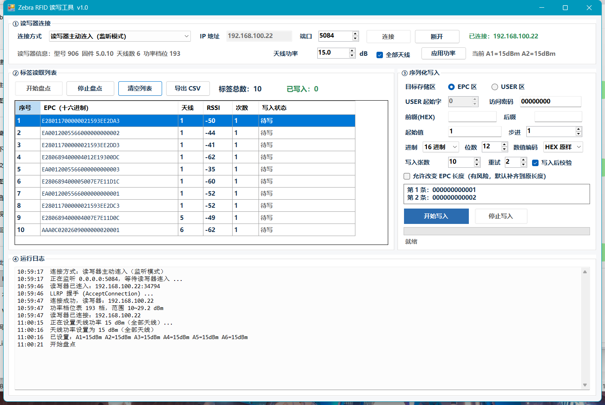

# Zebra RFID 读写工具（Windows 上位机）

给 Zebra 固定式读写器（FRX90 / FX9600 / FX7500）用的盘点 + 序列化写标签工具。
基于 **Zebra FXSeries Host .NET SDK**（`Symbol.RFID3.Host.dll` + `rfidapi32pc.dll`），
.NET Framework 4.8 / WinForms / x64，不需要 Visual Studio（`dotnet build` 即可编译）。



## 文档

- [使用手册（操作员版）](docs/使用手册.md) —— 现场怎么连、怎么盘点、怎么设序列化、出错怎么办
- [技术说明（开发版）](docs/技术说明.md) —— SDK 行为、自动重连设计、写入单位、高 DPI 方案、踩过的坑
- [变更记录](CHANGELOG.md)

> 仓库**不含** Zebra 的 `Symbol.RFID3.Host.dll` / `rfidapi32pc.dll`（版权归 Zebra），
> 请自行安装 Zebra FXSeries Host .NET SDK 后按下方"交付物"说明拷贝。

## 功能

| 区块 | 能力 |
|---|---|
| ① 连接 | 两种模式：读写器主动连入（LLRP Client，本机监听）/ 本机主动连接（LLRP Server）。IP 栏始终可编辑：监听模式下作为"只接受该 IP"过滤，留空=任意；主动模式下为连接目标。会话掉线自动重连，无需手动断开/连接 |
| ② 读取 | 开始/停止盘点，实时标签列表（EPC / 天线 / RSSI / 次数 / 写入状态）+ 标签总数、已写入计数，导出 CSV，右键复制 EPC、还原原始 EPC |
| ③ 写入 | 目标区 EPC / USER 可选（USER 可设起始字偏移）；序列化 = 前缀(HEX) + 起始值 + 进制(16/10) + 位数(补零) + 步进 + 后缀(HEX)，数值编码可选 HEX 原样 / ASCII；`写入张数`、`重复`（同值连写几张）、`重试`、`访问密码`、`写入后校验`、`允许改变 EPC 长度`；逐张写入并按张回报状态，中途掉线自动等重连再继续 |
| ④ 日志 | 全过程时间戳日志 |

天线功率（10~29.2 dBm，可选全部天线或单根）：调低可明显减少串读远处/无关标签。

## 交付物

`bin\Release\` 目录下三个文件一起拷走即可运行（无需安装 .NET）：

```
RfidWriter.exe
Symbol.RFID3.Host.dll      ← 来自 C:\Program Files\Zebra RFID FXSeries Host .NET SDK\SDK\
rfidapi32pc.dll            ← 来自 SDK 的 Samples\C#\CS_RFID3_Host_Sample1\
```

## 现场配置（本机实测环境）

- 读写器 FRX90：`192.168.100.22`，型号 906，固件 5.0.10，6 天线，193 个功率档位
- 读写器 Web UI 中 LLRP `Operating Mode = Client`，目标 host `192.168.100.13` 端口 `5084`
  → 程序保持默认「读写器主动连入（监听模式）」，端口 5084，点"连接"等它连进来即可
- 若把读写器改回 `Server` 模式：连接方式切第二项，IP 填 `192.168.100.22`，端口 5084

## 命令行自测（不依赖界面，均可复现）

```bat
RfidWriter.exe                      :: 正常启动界面
RfidWriter.exe --inv 5084 6         :: 连接并盘点 6 秒，打印标签总数与 EPC
RfidWriter.exe --diag 5084          :: 盘点→停止→设功率→写回原值→再盘点，验证停止后仍可写
RfidWriter.exe --killtest 5084      :: 强制掉线，验证自动重连 + 重连后写入
RfidWriter.exe --filtertest 5084 192.168.100.22   :: 验证监听 IP 过滤
RfidWriter.exe --repeatplan 6 2     :: 打印"重复次数"写入计划（不动标签）
RfidWriter.exe --powerinfo 5084     :: 打印功率档位表与各天线当前功率
RfidWriter.exe --restore 5084 <当前EPC> <原始EPC>  :: 定点还原某个标签 EPC
RfidWriter.exe --selftest 5084 2    :: 写入序列号并还原（会真的改标签，慎用）
```

## 已知坑（务必先看）

1. **EPC 长度不要随便改**：把 96 位标签写成更短会成功，但再写回长 EPC 可能失败并留下
   *部分写入* 的脏 EPC。程序默认把数据补齐到该标签原 EPC 长度；"允许改变 EPC 长度"是风险开关。
   误写了用右键"还原该标签为原始 EPC"或 `--restore`。
2. **重复写 EPC 会让多张标签 EPC 完全相同**，之后无法按 EPC 区分/单独还原。要保留区分能力
   请把相同批次数据写 USER 区，EPC 保持唯一。
3. `RFIDReader.Events` 必须先用 `new RFIDReader(host, port, timeout)` 构造（或设好 HostName/Port）
   才能访问，否则抛 `InvalidUsageException`，未捕获时会表现为"由于 Exception.ToString() 失败…"崩溃。
4. 连接状态不要直接信 SDK 的 `IsConnected`（某些状态会误报 false/抛异常）；程序自己维护标志，
   并要求连续 3 次 false 才判定掉线。
5. 高 DPI（125%）下不要用 `AutoScaleMode.Dpi`+手工 `AutoScaleDimensions`（会反向缩到 0.8）；
   本程序用 `AutoScaleMode.None` + manifest `dpiAware=true` + 启动时按 `DpiX/96` 等比缩放控件。

## 源码结构

```
src\RfidWriter\
  Program.cs        入口 + 命令行分支
  MainForm.cs       界面与业务流程（序列化、逐张写入、进度与状态）
  RfidEngine.cs     SDK 封装：连接/监听自动重连、盘点、写 EPC/USER、读回校验
  AntennaPower.cs   功率档位表换算（FXR90 原始值是 dBm×100）与逐天线设置
  SerialFormat.cs   序列化发号（前缀/起始/进制/位数/步进/后缀/ASCII 编码/重复映射）
  Diag.cs KillTest.cs FilterTest.cs PowerProbe.cs RepeatPlan.cs Restore.cs Inv.cs SelfTest.cs
                    各命令行自测与诊断
probe\              早期 API 反射 dump 与真机探测小工具（rfidprobe.exe）
```

## 构建

```bat
cd src\RfidWriter
dotnet build -c Release
```

要求：.NET SDK（8/9/10 均可）+ .NET Framework 4.8 targeting pack（Windows 自带）+ 上述两个 SDK DLL。
